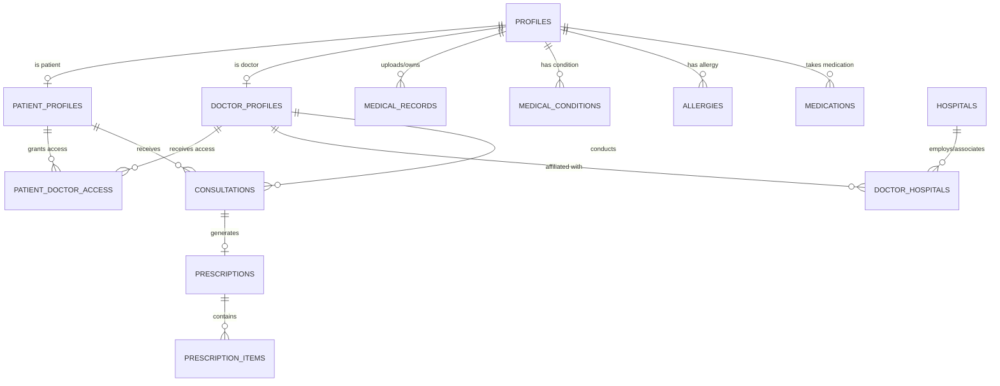

# HOSAI — AI-Powered Healthcare Management Platform
## Master Architecture & Implementation Plan

> **Role**: Senior Full-Stack Engineer, UI/UX Designer, and Software Architect  
> **Target**: Polished, functional, production-grade hackathon prototype of HOSAI  
> **Design Philosophy**: Emil Kowalski craft engineering (micro-interactions, snappy feedback, invisible correctness) + Impeccable clinical UI design (progressive disclosure, high-clarity typography, restrained healthcare palette).

---

## 1. Executive Overview & Product Vision

**HOSAI** is a centralized healthcare platform that bridges the communication and record fragmentation between **Patients**, **Doctors**, and **Hospitals**. 

### The Core Problem
Patient medical records are currently siloed across disconnected clinics, physical paper files, and separate lab portals. When patients visit new doctors or emergencies occur, doctors lack immediate access to critical medical history, current medications, and life-threatening allergies.

### The HOSAI Solution
- **Patients** maintain a single, lifelong, verified digital medical passport with full ownership: diagnoses, allergies, current medications, and uploaded lab/imaging records.
- **Doctors** gain instant, secure access to authorized patient records with proactive safety alerts (e.g., drug-allergy warnings) and can document consultations and structured digital prescriptions.
- **Hospitals** and healthcare facilities are discoverable by location, department, and specialty, connecting care networks.
- **Admins** oversee doctor credential verification (medical license checks) and maintain healthcare facility integrity.
- **AI Health Assistant** empowers patients to understand complex lab reports and clinical jargon, summarizes longitudinal health records, and guides them toward appropriate medical specialists with strict safety guardrails (no independent diagnosis or prescribing).

---

## 2. Technology Stack & Architecture

| Layer | Technology | Purpose |
|---|---|---|
| **Framework** | Next.js 16.4+ (App Router) | High-performance React 19 architecture with Server & Client components |
| **Language** | TypeScript (Strict mode) | Type safety across database schemas, APIs, and UI props |
| **Styling** | Tailwind CSS v4 | Clean utility styling with custom healthcare palette and micro-interactions |
| **Icons** | Lucide React | Consistent, accessible clinical and interface iconography |
| **Notifications** | Sonner | Crisp, responsive toast notifications adhering to Emil Kowalski's guidelines |
| **Database & Auth** | Supabase (PostgreSQL 15+) | Relational data integrity, Auth, and Row-Level Security (RLS) |
| **File Storage** | Supabase Storage / Client Blob | Secure document and imaging storage for medical records |
| **Data Resiliency** | Hybrid Supabase + Seed Store | Production Supabase client with local reactive store fallback for instant zero-config hackathon demoing |

---

## 3. Database Schema & Row-Level Security (RLS)

The database schema is designed for strict relational integrity, foreign-key cascade behaviors, and fine-grained RLS access control.

### 3.1 Entities & Relational Design

1. **`profiles`**
   - `id`: UUID (Primary Key, references `auth.users.id`)
   - `email`: TEXT UNIQUE NOT NULL
   - `full_name`: TEXT NOT NULL
   - `phone`: TEXT
   - `role`: ENUM (`'patient'`, `'doctor'`, `'admin'`)
   - `avatar_url`: TEXT
   - `location`: TEXT
   - `created_at`: TIMESTAMPTZ DEFAULT NOW()
   - `updated_at`: TIMESTAMPTZ DEFAULT NOW()

2. **`patient_profiles`**
   - `id`: UUID (Primary Key, references `profiles.id`)
   - `date_of_birth`: DATE NOT NULL
   - `blood_group`: ENUM (`'A+'`, `'A-'`, `'B+'`, `'B-'`, `'AB+'`, `'AB-'`, `'O+'`, `'O-'`)
   - `gender`: ENUM (`'male'`, `'female'`, `'other'`, `'prefer_not_to_say'`)
   - `emergency_contact_name`: TEXT NOT NULL
   - `emergency_contact_phone`: TEXT NOT NULL
   - `emergency_contact_relation`: TEXT NOT NULL
   - `insurance_provider`: TEXT
   - `insurance_policy_number`: TEXT
   - `created_at`, `updated_at`: TIMESTAMPTZ

3. **`doctor_profiles`**
   - `id`: UUID (Primary Key, references `profiles.id`)
   - `specialization`: TEXT NOT NULL (e.g., Cardiology, Neurology, General Medicine)
   - `qualifications`: TEXT[] NOT NULL (e.g., MBBS, MD, FRCP)
   - `experience_years`: INTEGER NOT NULL
   - `registration_number`: TEXT UNIQUE NOT NULL (Medical Council License)
   - `verification_status`: ENUM (`'pending'`, `'verified'`, `'rejected'`) DEFAULT `'pending'`
   - `bio`: TEXT
   - `consultation_fee`: NUMERIC(10,2)
   - `created_at`, `updated_at`: TIMESTAMPTZ

4. **`hospitals`**
   - `id`: UUID PRIMARY KEY DEFAULT gen_random_uuid()
   - `name`: TEXT NOT NULL
   - `address`: TEXT NOT NULL
   - `city`: TEXT NOT NULL
   - `state`: TEXT
   - `contact_phone`: TEXT NOT NULL
   - `contact_email`: TEXT
   - `emergency_helpline`: TEXT
   - `departments`: TEXT[] (e.g., Cardiology, Emergency, Pediatrics, Oncology)
   - `services`: TEXT[] (e.g., 24/7 ICU, MRI, Ambulance, Pharmacy)
   - `rating`: NUMERIC(3,2) DEFAULT 4.8
   - `is_verified`: BOOLEAN DEFAULT TRUE
   - `created_at`: TIMESTAMPTZ

5. **`doctor_hospitals`**
   - `id`: UUID PRIMARY KEY DEFAULT gen_random_uuid()
   - `doctor_id`: UUID REFERENCES `doctor_profiles(id)` ON DELETE CASCADE
   - `hospital_id`: UUID REFERENCES `hospitals(id)` ON DELETE CASCADE
   - `visiting_hours`: TEXT
   - `is_primary`: BOOLEAN DEFAULT FALSE

6. **`patient_doctor_access`**
   - `id`: UUID PRIMARY KEY DEFAULT gen_random_uuid()
   - `patient_id`: UUID REFERENCES `profiles(id)` ON DELETE CASCADE
   - `doctor_id`: UUID REFERENCES `profiles(id)` ON DELETE CASCADE
   - `access_status`: ENUM (`'active'`, `'revoked'`, `'pending'`) DEFAULT `'active'`
   - `granted_at`: TIMESTAMPTZ DEFAULT NOW()
   - `expires_at`: TIMESTAMPTZ
   - UNIQUE(`patient_id`, `doctor_id`)

7. **`medical_conditions`**
   - `id`: UUID PRIMARY KEY DEFAULT gen_random_uuid()
   - `patient_id`: UUID REFERENCES `profiles(id)` ON DELETE CASCADE
   - `disease_name`: TEXT NOT NULL
   - `description`: TEXT
   - `status`: ENUM (`'active'`, `'managed'`, `'in_remission'`, `'resolved'`) DEFAULT `'active'`
   - `diagnosed_date`: DATE NOT NULL
   - `created_at`: TIMESTAMPTZ

8. **`allergies`**
   - `id`: UUID PRIMARY KEY DEFAULT gen_random_uuid()
   - `patient_id`: UUID REFERENCES `profiles(id)` ON DELETE CASCADE
   - `allergen`: TEXT NOT NULL (e.g., Penicillin, Peanuts, Latex)
   - `reaction`: TEXT NOT NULL (e.g., Anaphylaxis, Rash, Angioedema)
   - `severity`: ENUM (`'mild'`, `'moderate'`, `'severe'`, `'life_threatening'`) NOT NULL
   - `notes`: TEXT
   - `created_at`: TIMESTAMPTZ

9. **`medications`**
   - `id`: UUID PRIMARY KEY DEFAULT gen_random_uuid()
   - `patient_id`: UUID REFERENCES `profiles(id)` ON DELETE CASCADE
   - `medication_name`: TEXT NOT NULL
   - `dosage`: TEXT NOT NULL (e.g., 10mg, 500mg)
   - `frequency`: TEXT NOT NULL (e.g., Twice daily after meals)
   - `duration`: TEXT (e.g., 30 days, Ongoing)
   - `status`: ENUM (`'active'`, `'completed'`, `'discontinued'`) DEFAULT `'active'`
   - `prescribed_by`: TEXT
   - `created_at`: TIMESTAMPTZ

10. **`medical_records`**
    - `id`: UUID PRIMARY KEY DEFAULT gen_random_uuid()
    - `patient_id`: UUID REFERENCES `profiles(id)` ON DELETE CASCADE
    - `uploaded_by`: UUID REFERENCES `profiles(id)`
    - `title`: TEXT NOT NULL
    - `record_type`: ENUM (`'lab_report'`, `'prescription'`, `'imaging_xray'`, `'discharge_summary'`, `'vaccination'`, `'other'`) NOT NULL
    - `record_date`: DATE NOT NULL
    - `file_url`: TEXT NOT NULL
    - `file_size_bytes`: BIGINT
    - `notes`: TEXT
    - `created_at`: TIMESTAMPTZ

11. **`consultations`**
    - `id`: UUID PRIMARY KEY DEFAULT gen_random_uuid()
    - `patient_id`: UUID REFERENCES `profiles(id)` ON DELETE CASCADE
    - `doctor_id`: UUID REFERENCES `profiles(id)` ON DELETE CASCADE
    - `consultation_date`: TIMESTAMPTZ DEFAULT NOW()
    - `symptoms`: TEXT NOT NULL
    - `observations`: TEXT NOT NULL
    - `diagnosis`: TEXT NOT NULL
    - `clinical_notes`: TEXT
    - `treatment_plan`: TEXT NOT NULL
    - `follow_up_date`: DATE
    - `created_at`: TIMESTAMPTZ

12. **`prescriptions`**
    - `id`: UUID PRIMARY KEY DEFAULT gen_random_uuid()
    - `consultation_id`: UUID REFERENCES `consultations(id)` ON DELETE CASCADE
    - `patient_id`: UUID REFERENCES `profiles(id)` ON DELETE CASCADE
    - `doctor_id`: UUID REFERENCES `profiles(id)` ON DELETE CASCADE
    - `prescription_date`: DATE DEFAULT CURRENT_DATE
    - `general_instructions`: TEXT
    - `is_dispensed`: BOOLEAN DEFAULT FALSE
    - `created_at`: TIMESTAMPTZ

13. **`prescription_items`**
    - `id`: UUID PRIMARY KEY DEFAULT gen_random_uuid()
    - `prescription_id`: UUID REFERENCES `prescriptions(id)` ON DELETE CASCADE
    - `medicine_name`: TEXT NOT NULL
    - `dosage`: TEXT NOT NULL
    - `frequency`: TEXT NOT NULL
    - `duration`: TEXT NOT NULL
    - `instructions`: TEXT (e.g., Take with plenty of water)

### 3.2 Row-Level Security (RLS) Policies
- **`profiles`**: Any authenticated user can read public doctor/hospital profiles. Users can update their own profile. Admins can read and update all profiles.
- **`patient_profiles`**: Patients can read and update only their own profile. Doctors can read patient profiles only if an active row exists in `patient_doctor_access`.
- **`medical_conditions`, `allergies`, `medications`, `medical_records`**:
  - `SELECT`: Allowed if `auth.uid() = patient_id` OR `EXISTS (SELECT 1 FROM patient_doctor_access WHERE doctor_id = auth.uid() AND patient_id = record.patient_id AND access_status = 'active')` OR user has admin role.
  - `INSERT / UPDATE / DELETE`: Allowed for patient on their own records, or verified doctors for consultation-linked records.
- **`consultations`, `prescriptions`**:
  - `SELECT`: Patient or conducting doctor or admin.
  - `INSERT`: Doctors who have active access to the patient.
- **`doctor_profiles`**:
  - `SELECT`: Public.
  - `UPDATE`: Doctor updates bio/specialty. Admin updates `verification_status`.

---

## 4. User Roles & Workflows

### 4.1 Patient Journey
1. **Registration & Onboarding**: Patient signs up, specifies DOB, blood group, emergency contact.
2. **Health Profile Management**: Logs active medical conditions (e.g., Hypertension, Type 2 Diabetes), drug/food allergies (e.g., Penicillin - Severe Anaphylaxis), and current prescriptions.
3. **Record Upload**: Uploads lab reports, imaging files, or discharge summaries with category tags and dates.
4. **Care Team Discovery**: Searches verified doctors by specialty (Cardiology, Dermatology, etc.) and discovers nearby healthcare facilities/hospitals.
5. **Granting Access**: Connects with a doctor, granting them explicit permission to review their medical passport.
6. **Timeline & Prescriptions**: Sees all past doctor consultations, clinical notes, and digital prescriptions in chronological order with safety indicators.
7. **AI Health Assistant**: Consults the embedded HOSAI AI assistant to clarify lab report terms (e.g., "What does elevated ALT mean?") or summarize recent treatments with medical disclaimers.

### 4.2 Doctor Journey
1. **Professional Workspace**: Doctor dashboard displays verification badge, affiliated hospitals, and authorized patient roster.
2. **Patient Medical Passport**: Doctor opens an authorized patient file.
3. **Safety Alert System**: Prominently displays high-risk alerts at the top (Allergies in high-contrast red/amber; current medications to prevent contraindications).
4. **Record Review**: Inspects patient's historical lab reports, previous consultations from other specialists, and diagnostic scans.
5. **Clinical Documentation**: Doctor adds a new consultation: records symptoms, objective findings, diagnosis, clinical treatment plan, and follow-up date.
6. **Digital Prescription Builder**: Adds structured medication items (Drug name, dosage, frequency, duration, special instructions) which are signed and instantly linked to the patient's record.

### 4.3 Admin Journey
1. **Platform Analytics**: Real-time counters of active patients, registered doctors, verified hospitals, and consultations logged.
2. **Doctor Verification Queue**: Review doctor applications, check medical registration/license numbers, view qualifications, and toggle verification status (`verified` or `rejected`).
3. **Hospital Management**: Add and manage hospital directory listings, emergency contact numbers, and department offerings.
4. **User Directory**: View and manage all platform accounts and role permissions.

---

## 5. UI/UX Design System (Emil Kowalski Craft & Impeccable Standards)

### 5.1 Visual Foundation
- **Backgrounds**: Slate-50 / Zinc-50 base `#f8fafc`, pristine white `#ffffff` cards with subtle borders `border-slate-200/80` and gentle shadows `shadow-xs`.
- **Primary Clinical Blue**: Deep sapphire `#0f172a` (foreground) and clinical azure `#0284c7` / `#2563eb` for primary actions.
- **Semantic Accents**:
  - `emerald-600` / `emerald-50`: Healthy, active, verified, safe
  - `amber-600` / `amber-50`: Managed conditions, mild/moderate allergies
  - `rose-600` / `rose-50`: Severe allergies, high-risk warnings, critical alerts
  - `indigo-600` / `indigo-50`: Prescriptions, doctor consultations
- **Typography Hierarchy**:
  - Titles: Crisp Geist font, semi-bold (`font-semibold tracking-tight`), high readability.
  - Body: Readable slate-600 to slate-900, appropriate line heights (`leading-relaxed`).
  - Metadata: Subtle slate-400/500 with uppercase micro-labels (`text-xs font-medium uppercase tracking-wider`).

### 5.2 Micro-Interactions & Animation Standards
- **Button Feedback**: `active:scale-[0.98] transition-transform duration-150 ease-out`.
- **Card Hover**: Subtle elevate `hover:border-slate-300 hover:shadow-sm transition-all duration-200 ease-out`.
- **Progressive Disclosure**:
  - Tabbed patient passport: "Overview", "Allergies & Conditions", "Medications", "Medical Records", "Consultation History".
  - Expandable consultation accordion: Doctors and patients can click to expand full clinical notes and prescriptions without initial cognitive overload.
- **Toasts**: Integrated Sonner notifications for every mutation (Save condition, upload record, issue prescription, verify doctor).

---

## 6. Detailed Implementation Milestones

### Milestone 1: Project Setup, Icons & UI Tokens
- [x] Inspect existing Next.js 16 structure and packages.
- [x] Install `lucide-react`, `sonner`, `@supabase/supabase-js`, `@supabase/ssr`, `clsx`, `tailwind-merge`.
- [x] Configure Tailwind tokens, fonts, and clean layout container with Sonner `<Toaster />`.

### Milestone 2: Schema, Types & Supabase Seed Layer
- [x] Define TypeScript interfaces in `types/database.ts` matching all 13 database entities.
- [x] Write SQL migration script `supabase/schema.sql` with tables, indexes, and RLS policies.
- [x] Write comprehensive seed SQL in `supabase/seed.sql` with realistic clinical demo data.
- [x] Build resilient data store `lib/store.ts` and `lib/supabase.ts` with local reactive seed data and Supabase client support.

### Milestone 3: Navigation, Layout & Demo Role Switcher
- [x] Top navigation bar with HOSAI branding, active role badge, user menu, and role switching.
- [x] Floating Hackathon Role Switcher allowing instant toggling between:
  - **Sarah Jenkins** (Patient)
  - **Dr. Marcus Vance** (Cardiologist, Doctor)
  - **Elena Rostova** (Chief Health Admin)
  - Custom registration / login flow.

### Milestone 4: Patient Portal
- [x] Patient Dashboard: Quick summary (blood group, allergies count, active meds, upcoming follow-up).
- [x] Health Profile: Blood group, DOB, emergency contact editing.
- [x] Medical Conditions Manager: Add, edit, filter conditions with status pills.
- [x] Allergy Safety Center: Allergen, reaction type, severity indicators (mild to life-threatening).
- [x] Current Medications: List with dosage, frequency, prescribing physician.
- [x] Medical Records Vault: Chronological list, category filter (Lab, Imaging, Prescription, Discharge), and interactive upload modal with drag-and-drop file simulator.
- [x] Consultations & Prescriptions View: Rich clinical summary cards with signed doctor badge, diagnosis, and prescription items table.

### Milestone 5: Doctor Portal
- [x] Doctor Dashboard: Verification status banner, total authorized patients, daily consultations.
- [x] Patient Roster: Authorized patient list with search, blood group, last visit.
- [x] Patient Full Medical Passport View: Complete authorized history.
- [x] Prominent Safety Warning Bar: Flags allergies and active medications at the top of the patient chart.
- [x] New Consultation & Clinical Note Editor:
  - Symptoms & physical observations.
  - Diagnosis & ICD-friendly clinical notes.
  - Treatment plan & follow-up date picker.
- [x] Interactive Prescription Builder: Add multiple medications (name, dosage, frequency, duration, instructions) and generate official prescription.

### Milestone 6: Admin Portal
- [x] Platform Overview: Metrics cards (Patients, Doctors, Hospitals, Consultations).
- [x] Doctor Verification Queue: Review qualifications, license number, specialty, and one-click "Approve" or "Reject".
- [x] Hospital Directory Manager: Add new hospitals, manage department tags, emergency contact numbers.
- [x] User Directory: View system profiles, filter by role.

### Milestone 7: Discovery & AI Healthcare Assistant
- [x] Doctor Directory: Search and filter by specialty, experience, location, and hospital affiliation.
- [x] Hospital Directory: Search nearby facilities, filter by departments (ICU, Cardiology, Emergency, etc.).
- [x] HOSAI AI Health Assistant:
  - Contextual sidebar / modal drawer.
  - Grounded in patient's authorized conditions, medications, and allergies.
  - Explain lab reports in plain English.
  - Clinical safety guardrails with bold medical disclaimer: "Educational assistant only. Not a medical diagnosis or prescription."

### Milestone 8: End-to-End Verification of Definition of Done
- [x] Verify Patient registration and profile completion.
- [x] Verify adding allergies, diseases, and medications.
- [x] Verify uploading a medical report with category and preview.
- [x] Verify Doctor access to authorized patient's chart.
- [x] Verify Doctor reviews previous history and adds consultation + prescription.
- [x] Verify Patient immediately sees updated consultation and prescription.
- [x] Verify Doctor & Hospital discovery with search and filters.
- [x] Verify AI assistant provides accurate contextual guidance.
- [x] Verify Admin approves/verifies doctor and manages hospital directory.
- [x] Ensure 0 build or lint errors (`npm run build`).

---

## 7. Potential Technical Pitfalls & Proactive Solutions

1. **Next.js 16 Async Page Props**: In Next.js 15+, `params` and `searchParams` are Promises. We will use client-side search query state or await params properly to prevent runtime crashes.
2. **Missing Remote Supabase Credentials during Hackathon Evaluation**:
   - *Solution*: A hybrid state store in `lib/store.ts` pre-seeded with rich, realistic clinical data (Sarah Jenkins, Dr. Marcus Vance, Elena Rostova, Metro General Hospital, etc.). If Supabase URL and Key are provided in `.env.local`, it communicates with Supabase; otherwise, it operates seamlessly with reactive local state so judges never hit an empty error screen!
3. **Information Overload for Doctors/Patients**:
   - *Solution*: Strict progressive disclosure. The patient passport uses segmented tabs and expandable accordions so doctors only see the details they need without cognitive exhaustion.
4. **AI Liability & Medical Safety**:
   - *Solution*: Explicit medical disclaimer banner, structured prompting that prevents hallucinated prescriptions, and clear referral suggestions to human specialists.
